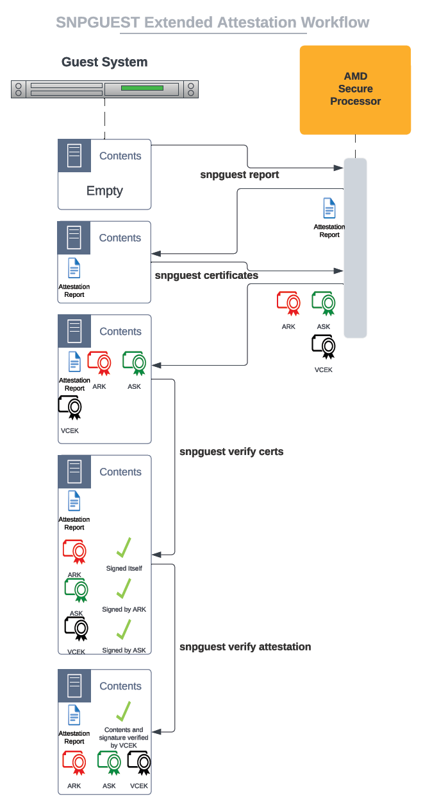
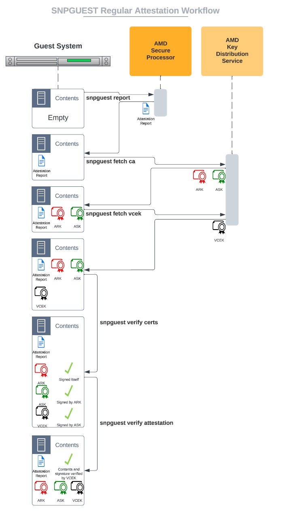

# Attestation Workflow

## Extended Attestation Workflow



### Step 1. Request an attestation report

Request an attestation report from the guest VM by providing the two mandatory
parameters `$ATT_REPORT_PATH` (path to which the report is stored) and
`$REQUEST_FILE` (path to the request file). The request file is a 64-byte binary
which will be bound in the `REPORT_DATA` field of the attestation report.

The optional parameter `-v, --vmpl` specifies the vmpl level for the attestation
report and is set to `1` by default. The flag `-r, --random` generates random data
to be used as request data for the attestation report.

```bash
snpguest report $ATT_REPORT_PATH $REQUEST_FILE [-v, --vmpl] $VMPL [-r, --random]
```

### Step 2. Request host-cached certificates

Request the certificate chain from the extended memory by providing the two
mandatory parameters:

- `$ENCODING` which specifies whether to use PEM or DER encoding to store the
  certificates
- `$CERTS_DIR` which specifies the path in the user's directory where the
  certificates will be saved

```bash
snpguest certificates $ENCODING $CERTS_DIR
```

In some environments, only the leaf certificate (VCEK/VLEK) can be obtained. In
this case, you must follow the procedure described in [Regular Attestation Workflow](#regular-attestation-workflow)
to obtain the AMD CA certificates.

### Step 3. Verify the certificate chain

Verify the certificates obtained from the extended memory by providing `$CERTS_DIR`
which specifies the path in the user's directory where the certificates were saved
from Step 2.

```bash
snpguest verify certs $CERTS_DIR
```

### Step 4. Verify the attestation report

Verify the attestation report by providing the two mandatory parameters:

- `$CERTS_DIR` which specifies the path in the user's directory where the
  certificates were saved from Step 2
- `$ATT_REPORT_PATH` which is the path pointing to the stored attestation
  report which the user wishes to verify.

The optional parameters `-t, --tcb` is used to verify only the Reported TCB
contents of the attestaion report and `-s, --signature` is used to verify just
the signature of the attestaion report.

```bash
snpguest verify attestation $CERTS_DIR $ATT_REPORT_PATH [-t, --tcb] [-s, --signature]
```

## Regular Attestation Workflow



### Step 1. Request an attestation report

This step is completely the same as in the extended attestation.

```bash
snpguest report $ATT_REPORT_PATH $REQUEST_FILE [-v, --vmpl] $VMPL [-r, --random]
```

### Step 2-1. Request CA certificates from AMD KDS

Request the AMD CA certificates from the AMD Key Distribution Service (KDS) by
providing the three mandatory parameters:

- `$ENCODING` which specifies whether to use PEM or DER encoding to store the
  certificates
- `$CERTS_DIR` which specifies the path in the user's directory where the
  certificates will be saved
- `$PROCESSOR_MODEL` - which specifies the AMD Processor model for which the
  certificates are to be fetched

The optional `-e, --endorser` argument specifies the type of attestation
signing key (defaults to VCEK).

```bash
snpguest fetch ca $ENCODING $CERTS_DIR $PROCESSOR_MODEL [-e, --endorser] $ENDORSER
```

This yields the AMD root CA certificate called the AMD Root Key (ARK) and the
AMD intermediate CA certificate called the AMD SEV Key (ASK) for the VCEK
signing key or the AMD SEV-VLEK Key (ASVK) for the VLEK certificate.

### Step 2-2. Request leaf certificate from AMD KDS

Request the leaf certificate (the certificate for the report signing key) from
AMD KDS with the following mandatory parameters:

- `$ENCODING` which specifies whether to use PEM or DER encoding to store the
  certificates
- `$CERTS_DIR` which specifies the path in the user's directory where the
  certificates will be saved
- `$ATT_REPORT_PATH` which is the path pointing to the stored attestation report
  for detecting Chip ID and Reported TCB Version.

The optional `-p, --processor-model` argument specifies the AMD Processor model
for which the certificates are to be fetched. This option is mandatory when the
processor model cannot be determined by the report contents.

```bash
snpguest fetch vcek $ENCODING $CERTS_DIR $ATT_REPORT_PATH [-p, --processor-model] $PROCESSOR_MODEL
```

This yields the leaf certificate called the Versioned Chip Endorsement Key (VCEK)
certificate.

Note that the AMD KDS does not provide Versioned Loaded Key (VLEK) certificates,
which are often used by cloud confidential computing platforms. To retrieve VLEK,
please follow the instructions provided by the platformer.

### Step 3. Verify the certificate chain

```bash
snpguest verify certs $CERTS_DIR
```

### Step 4. Verify the attestation report

```bash
snpguest verify attestation $CERTS_DIR $ATT_REPORT_PATH [-t, --tcb] [-s, --signature]
```
